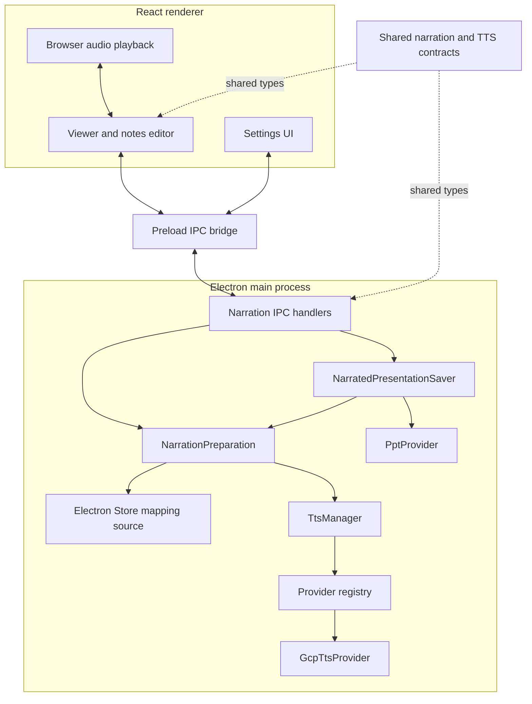
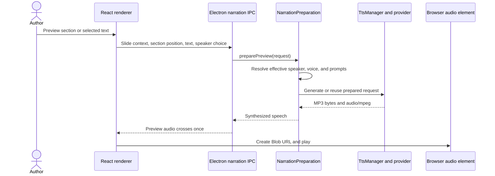
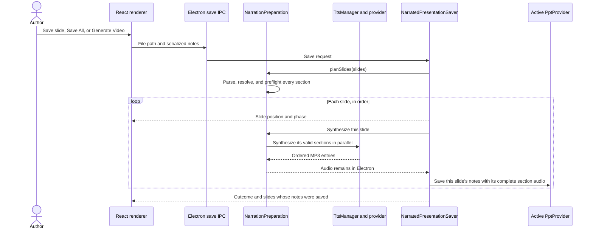

# Power Narrator

Power Narrator is a macOS Electron application for preparing spoken narration from PowerPoint
speaker notes. It lets presentation authors edit multi-speaker notes, preview the effective voice,
save notes and synthesized audio back into a `.pptx`, and export the narrated presentation as an
MP4.

Google Cloud Text-to-Speech is the only production narration provider currently shipped. Stored
voices retain their provider, model, and language choices, and synthesis is routed through a
provider registry so another adapter can be added without changing narration preparation.

## Features

- Load a `.pptx` and view slide images and notes side by side.
- Split notes into multiple note sections and assign speaker aliases.
- Choose a Google Cloud voice, model, and language for each speaker from a searchable catalogue.
- Give a speaker a preset delivery prompt or add an inline prompt to one note section.
- Preview a whole section or the currently selected text with the effective speaker or a temporary
  speaker choice.
- Add supported SSML markup with the editor toolbar.
- Save one slide or the complete presentation with PowerPoint-compatible MP3 narration.
- Remove managed narration from one slide or every slide.
- Reload one slide or synchronize the whole presentation with PowerPoint.
- Export the fully prepared presentation to MP4.
- Use the experimental bundled XML CLI for direct notes and audio changes to the `.pptx` package.

## Requirements

- macOS
- A current Node.js LTS release
- pnpm
- A licensed desktop installation of Microsoft PowerPoint
- A Google Cloud service-account JSON key with access to Text-to-Speech

The production PowerPoint workflow is macOS-only. A Windows provider skeleton exists, but its
operations are not implemented.

## Quick start

```bash
git clone git@github.com:power-narrator/power-narrator-fe.git
cd power-narrator-fe
pnpm install
cp .env.example .env
pnpm run dev
```

Set `GOOGLE_APPLICATION_CREDENTIALS` in `.env` to the absolute path of a service-account JSON key,
or select the key from the application's Settings window. The environment variable takes
precedence when both are configured.

## Configure narration

1. Open **Settings** and select a Google Cloud service-account JSON key. If Settings was already
   open before choosing the key, close and reopen it to refresh the voice catalogue.
2. Choose a **Default Voice (No Tag)**, then its model and language. Narration that needs a default
   fails until every choice is made.
3. Add each speaker alias used by the presentation and choose its voice, model, and language.
4. Optionally add a preset prompt to a mapping. It applies to every section that speaker narrates.

The searchable Google Cloud catalogue offers Chirp 3 HD and four Gemini models. Each voice
name-and-gender combination appears once; model and language are separate choices. A choice with
one available option is selected automatically, while multiple options remain unselected until the
author chooses. Model and language labels identify choices that Google marks as preview.
Gemini models have no free tier.

A stored voice records its provider, provider voice key, model, language, and whether that model
accepts prompts. There is no separate provider preference: each speaker mapping's voice determines
its synthesis route. The mapping also stores its optional preset prompt independently of the voice,
so changing models does not destroy the prompt. If the selected model does not accept prompts, the
app keeps the prompt, displays an advisory, and narrates without sending it to Google.

Mappings and the selected key path are persisted with Electron Store. Legacy Chirp mappings are
migrated once to the current shape. A mapping whose old voice cannot be recovered keeps its speaker
alias but remains unconfigured, so the author can replace that voice in Settings. Stored mappings
remain available without credentials or network access; only opening Settings fetches the voice
catalogue.

### Note format and effective speakers

Put an optional speaker tag at the start of a section and separate sections with a line containing
at least three hyphens. An optional inline prompt follows the speaker tag and applies only to that
section:

```text
[Narrator]
[prompt: Warm and welcoming]
Welcome to the presentation.
---
This section inherits Narrator.
---
[Reviewer]
[p: Sound doubtful]
Here is another point of view.
```

Prompt markers may use `p` or `prompt`, are case-insensitive, allow whitespace around the marker
and colon, and may span lines. Everything after the colon is the prompt exactly as written, spacing
included, so the editor never rewrites spacing an author typed; surrounding whitespace is trimmed
only on the way to a provider. A prompt can also start a section with no speaker tag. When both a
preset and inline prompt exist, narration sends the preset first and the inline prompt second.
Clearing an inline prompt removes its marker from the notes.

Only bracketed names that match a configured speaker mapping are speaker tags. Other bracketed
lines, including Gemini style tags such as `[sigh]` and misspelled speaker names, remain narration
text. New speaker names cannot use syntax reserved for note directives.

For every non-empty section, narration preparation resolves one effective speaker:

1. An explicit non-empty speaker tag on the section wins.
2. Otherwise, the section inherits the nearest earlier explicit speaker on the same slide.
3. If the slide has no earlier explicit speaker, the configured default voice is used.

Inheritance never crosses a slide boundary. Missing defaults, speaker mappings without a complete
voice, and unregistered provider identifiers are validation errors with slide, section, and speaker
context. Whitespace-only sections are skipped during a narrated save.

The editor normalizes the line-ending variants PowerPoint can produce while preserving intentional
whitespace around section dividers, speaker tags, and prompt markers during parse-and-format round
trips. Its SSML toolbar can insert breaks, `say-as`, emphasis, and paragraph tags.

## Architecture

The React renderer owns editing state, live text selection, preview playback, and deciding when a
renderer operation would discard edits. Electron owns the native discard confirmation and window
close guard, authoritative speaker mappings, narration preparation, provider calls, persistent
caching, and PowerPoint mutation. Contracts used by both processes live under `shared/`; renderer
code does not import Electron implementation modules.



### Narration preparation module

`NarrationPreparation` is the deep module behind two use cases:

- `preparePreview` plans one section from the live slide context, resolves its preset and inline
  prompts, and passes it through the shared array-based synthesis path.
- `planSlides` parses all requested slides, skips empty text, resolves every effective speaker,
  combines its prompts, and validates every concrete voice before synthesis starts. Each planned
  slide then synthesizes its own valid sections in parallel on request, and its results retain
  source order.

Both paths trim surrounding text consistently and produce contextual validation or synthesis
errors. Preview cancellation only detaches the renderer request, preventing late playback; it does
not abort provider work that another caller may share or that can populate the cache.

`registerNarrationIpc` constructs the module from three adapters: the speaker-mapping source, the
narration synthesizer, and the active PowerPoint provider. Re-registering the handlers is the
supported injection seam used by end-to-end tests.

### Preview flow



With no selection, preview uses the complete current section. A selected range previews only that
range. The effective-speaker control follows the same resolution rules as save; choosing a named
speaker or Default explicitly is a temporary comparison and does not edit the notes. Replacing or
stopping playback revokes obsolete browser Blob URLs.

### Narrated save flow



Save All is a save-all run: the author confirms it first, a blocking progress modal shows the slide
position and phase, and the window cannot close or quit until the run settles. Slides are generated
and saved one complete slide at a time, so a slide is written only after all of its sections
synthesize, and no later slide starts before it is saved. Validation of every slide completes before
any synthesis or PowerPoint change. A failure stops the run, keeps earlier saved slides, and leaves
the failed and later slides untouched; the Viewer treats only notes confirmed saved as saved. A
failure reports what it left saved of the slide: nothing, only its notes (the XML CLI engine saves
notes before audio), or its notes and audio when a later step such as restoring the editing view
failed. An ordinary retry can reuse the synthesized cache entries. Save Slide uses the same path for
its single slide.

**Generate Video** first runs the same save-all run, with its own confirmation, progress modal, and
safe cancellation. The video destination is requested and export starts only after every slide's
notes and audio commit successfully; cancellation or any failure skips rendering. Rendering itself
cannot be cancelled.

### Synthesis cache

`TtsManager` keeps a persistent but disposable narration cache in the operating system's
application-cache location. On macOS it is:

```text
~/Library/Caches/power-narrator/narration/
```

Each entry is a SHA-256-named `.mp3` file. The identity is a deterministic serialization of the
provider identifier and the provider's prepared request—the same normalized request used for the
actual provider call. For Google Cloud that request contains the plain-text or normalized SSML
input, usable speaker prompt, concrete voice information, and MP3 output configuration. Any
audio-affecting change creates a different identity. A prompt ignored by a non-promptable model is
also omitted from the cache identity.

Simultaneous requests with the same identity share one pending provider call and publish one cache
entry. Unrelated requests remain parallel. A failed pending request is removed so the next request
can retry. Cache entries survive application restarts and have no application-managed age, count,
or size eviction. They can be deleted without losing notes, mappings, or other authored work; a
missing entry is synthesized again.

Every registered provider is expected to return PowerPoint-compatible MP3. The manager exposes
cached and newly synthesized results as `audio/mpeg`, and PowerPoint audio files use the
`ppt_audio_<section>.mp3` naming convention.

## PowerPoint providers

`PptProvider` isolates presentation operations from narration preparation:

- `MacPptProvider` uses AppleScript for PowerPoint automation and VBA macros from the bundled PPAM
  add-in for notes and audio operations.
- `XmlPptProvider` is the experimental alternate provider selected in Settings. It uses the bundled
  `electron/scripts/power-narrator-cli` executable to query and modify the PPTX package directly.
  With a native provider available, it closes and reopens the presentation around XML mutations.
  Slide image export still uses native PowerPoint automation, and video generation and slide
  playback always use the native provider.

For findings on Mac PowerPoint playback APIs, animation copying and alternative approaches, see
the [audio API research reference](docs/powerpoint/mac-audio-playback.md).

### Play Across Slides on Mac

Each note section's **Play Across Slides** choice is PowerPoint's own Play Across Slides checkbox
on the Playback tab: enabled is checked, disabled is unchecked. The app does not read or set a
number of slides; any slide limit stays as PowerPoint stores it. Enabled lets the audio continue
onto later slides under its other playback settings. It does not start the audio automatically or
promise that it plays through the whole presentation. See
[ADR 0006](docs/adr/0006-play-across-slides-is-a-boolean.md).

- **Loading and reloading** read each section audio's checkbox. Section audio without a Play
  animation cannot play, so it loads as disabled.
- **PowerPoint moves while it works.** The checkbox applies to whatever is selected, so loading and
  saving switch the presentation to Normal view, visit slides and select section audio. Once the
  batch finishes, successfully or not, the previous view, slide and selection are restored (a
  selected audio that was replaced becomes its replacement). If another presentation was active,
  PowerPoint comes forward to switch to this one, which then stays active, and the app you were
  using gets focus back. Keys typed into PowerPoint meanwhile reach it, so wait for the operation
  to finish.
- **Saving replaces each section's audio.** The replacement takes over the old audio's Play, Pause
  and Stop animations with their start, delay, repeat and rewind settings, its place in the slide's
  animation order, its click triggers (on the audio itself or on another shape such as a button),
  and its position, size, rotation, volume and mute. Only then is the checkbox clicked, and only
  when it differs from the section's choice; the app reads it back to confirm. New section audio
  plays after the previous one, sits beside the slide and uses 50% volume.
- **Setups the app cannot keep fail before anything changes.** Saving reports an error when section
  audio has animations other than Play, Pause or Stop, has animations but no Play, shares a click
  trigger with other shapes' animations, starts on a bookmark, starts another shape's animation,
  or has bookmarks, fades or trims. Remove that customization in PowerPoint or keep the slide out
  of the save.

Saving changes some stored timing the way PowerPoint itself does. A checked Play is stored with a
1 ms duration. Every unchecked section the app saves gets its clip length, because it is newly
added audio. Later After Previous animations on the slide therefore start that much earlier or
later. Unchecking by hand in PowerPoint keeps the old duration instead. The checkbox can also move
some stored delays slightly. See
[Saved Play duration](docs/powerpoint/mac-audio-playback.md#saved-play-duration) for details.

Saving a slide first saves the presentation as it is, including your own unsaved PowerPoint edits.
Only then does the app write the slide's notes and change its section audio, and it saves both
together once both succeed. Remove Audio likewise saves first, removes the section audio, then
saves again; it does not write notes. If that first save or a check before it fails, nothing was
changed and the presentation stays open. If the section audio cannot be replaced as it is, writing
the notes or changing the audio fails, or PowerPoint cannot confirm the slide's resulting section
audio and checkboxes, the app closes the presentation without saving and reopens it as saved just
before: the slide keeps its
previous notes and section audio, your earlier edits remain, and a later save cannot write the
failed edits. An error after the final save, such as failing to restore your editing view, leaves
the saved changes in place and says so. If PowerPoint stops responding after starting a save, so
the app cannot tell how far it got, the app also closes the presentation without saving and
reopens it as last saved, and says it cannot tell whether the slide was saved; check it in
PowerPoint, as edits PowerPoint had not saved yet may be lost. Earlier slides of a save-all run keep everything they saved,
and the run stops at the failed slide. If PowerPoint could not discard or reopen the presentation,
the error says so: close the presentation without saving before you continue.

### PowerPoint add-in

For VBA-backed notes and audio operations:

1. Open PowerPoint and choose **Tools → PowerPoint Add-ins…**.
2. Select **+** and open `electron/scripts/ppt-tools.ppam`.
3. Allow macro execution when prompted.

The source for the bundled macros is `electron/scripts/ppt-tools.bas`. The `.ppam` is compiled
from it by hand in PowerPoint's VBA editor, so no build step can regenerate it — both files are
committed, and a change to one must be accompanied by a recompile of the other. The tracked
`pre-commit` hook in `.githooks/` enforces this. The rebuild steps are at the top of the `.bas`
file. PowerPoint loads the `.ppam` from wherever it was added, so after rebuilding, add or copy
the new file there and restart PowerPoint. An add-in older than the app reports playback as a
number when loading. The app rejects that report as unreadable playback.
Saving with an older add-in fails because it has no `SaveNarration` macro, before any change.

### XML CLI mode

Enable **XML CLI Engine (Experimental)** in Settings to use the bundled CLI for reading and writing
notes and managed audio. It supports notes queries and updates plus managed-audio insertion and
removal. Slide rendering and video export still require the native macOS provider.

## Project structure

```text
shared/
  narration/
    NarrationSections.ts       Note parsing, formatting, and effective speakers
    prompt.ts                  Empty-prompt normalization
    speaker.ts                 Shared default-speaker and synthesis-speaker values
    speakerName.ts             Speaker-name and directive syntax rules
  types/
    narration.d.ts             Preview, save, progress, and failure contracts
    tts.d.ts                   Voice catalogue, stored voice, and mapping contracts

electron/
  main.ts                      Application bootstrap and non-narration IPC
  preload.cts                  Narrow renderer-to-Electron bridge
  narration/
    NarrationPreparation.ts    Preview and batch narration preparation
    NarratedPresentationSaver.ts
                               Prepare-before-mutate narrated save workflow
    registerNarrationIpc.ts    Adapter composition and narration IPC registration
  settings/
    speakerMappingMigration.ts One-shot conversion of legacy mappings
  tts/
    TtsProvider.ts             Provider and prepared-request interfaces
    TtsManager.ts              Provider registry, request identity, and disk cache
    GcpTtsProvider.ts          Google Cloud voice catalogue and MP3 synthesis
    gcpLanguages.ts            Documented Gemini language catalogue
    SsmlUtil.ts                Google Cloud SSML input normalization
  platform/
    PptProvider.ts             Presentation adapter contracts
    MacPptProvider.ts          AppleScript and VBA-backed macOS adapter
    XmlPptProvider.ts          Bundled XML CLI adapter
    WindowsPptProvider.ts      Unimplemented Windows placeholder
  testing/
    narrationTestHarness.ts    Test-only adapter injection seam
  windows/                     Window creation and unsaved-narration close guard
  scripts/                     AppleScript, VBA/PPAM, and bundled XML CLI assets

src/
  components/SpeakerPrompt.tsx Shared preset and inline prompt control
  components/settings/         Credentials, mappings, voices, and XML CLI settings
  components/viewer/           Slide viewer, notes editor, preview, and save UI
  context/                     Renderer settings and audio ownership

tests/
  e2e/                         Playwright Electron workflows
  native/                      PowerPoint provider contract run against real PowerPoint
  fixtures/                    Local presentation fixtures
```

The important architectural patterns are a deep narration-preparation module, shared cross-process
contracts, injected external-edge adapters, a provider registry for voice routing, and an alternate
PowerPoint provider behind a common interface.

## Testing and development

The normal test suite is deterministic and does not require Google credentials, network access,
provider quota, or a running speech service.

Static analysis uses oxlint's recommended presets for ESLint, type-checked TypeScript, React and
JSX, React Hooks, Vite React Refresh, Node.js, and Vitest. The TypeScript projects use the ES2023
library definitions while retaining their existing compilation targets.

- **Unit profile** (`pnpm run test:unit`) runs Node-based tests for shared parsing and speaker rules,
  Viewer state, Electron narration preparation and saves, caching, provider request formatting, and
  PowerPoint adapters.
- **Component profile** (`pnpm run test:component`) runs React interaction tests in headless Chromium,
  including settings, selection-aware preview, playback lifecycle, and Viewer save behavior.
- **Integration profile** (`pnpm run test:integration`) runs cross-module contracts with fake external
  edges, including compatibility between stored mapping migrations and providers.
- **End-to-end profile** (`pnpm run test:e2e`) builds and launches the real Electron app. With
  `NODE_ENV=test`, `powerNarratorTestHarness` replaces narration and PowerPoint edges with injected
  deterministic adapters. The fake TTS adapter returns valid fixed MP3 frames while requests still
  cross the real renderer/preload/Electron boundary.

Useful commands:

| Command                     | Purpose                                           |
| --------------------------- | ------------------------------------------------- |
| `pnpm run dev`              | Run Vite and Electron in development mode         |
| `pnpm run typecheck`        | Type-check renderer, shared, and Electron code    |
| `pnpm run lint`             | Run the configured oxlint preset suite            |
| `pnpm run format`           | Format the repository with oxfmt                  |
| `pnpm run test:unit`        | Run the Node unit profile                         |
| `pnpm run test:component`   | Run browser component tests                       |
| `pnpm run test:integration` | Run cross-module contract tests                   |
| `pnpm run test:e2e`         | Build and run Playwright Electron tests           |
| `pnpm run test`             | Run all four test profiles                        |
| `pnpm run test:native`      | Run the native PowerPoint provider tests          |
| `pnpm run build`            | Type-check and build renderer and Electron output |
| `pnpm run dist`             | Build distributable application packages          |

### Native PowerPoint provider tests

`pnpm run test:native` runs the shared PowerPoint provider contract against real PowerPoint, one
file at a time with long timeouts. It is never part of `pnpm run test`, and it needs no speech
service or credentials. Each case works on its own copy of `tests/fixtures/hand-built-deck.pptx`
and closes that copy without saving; the copy of a failed case is kept and its path printed.

On macOS it needs:

- PowerPoint for Mac;
- the add-in built from the current `ppt-tools.bas` and loaded in PowerPoint, reloaded and
  PowerPoint restarted after every add-in change;
- automation permission for the app that runs the command, to control PowerPoint;
- access for that app to the Office group container (`~/Library/Group Containers/UBF8T346G9.Office`),
  which macOS may require granting as access to other apps' data or as Full Disk Access.

A missing prerequisite fails the run with a message saying what to fix. Agent sessions must run the
command outside their sandbox, which cannot reach the Office group container.

The layout is:

- `tests/native/pptProviderContract.ts`: the shared cases, registered against a provider harness;
- `tests/native/*.native.test.ts`: one file per provider, which builds its harness, runs the
  contract and adds that provider's own cases. The Mac file skips itself on other systems;
- `tests/native/presentationInspector.ts`: a read-only, portable reader of saved presentations,
  whose own tests run in the unit profile;
- `tests/fixtures/hand-built-deck.md`: the recipe the deck was built from in PowerPoint's UI. Its
  fixture test, `tests/native/handBuiltDeck.test.ts`, runs in the unit profile.

The clips in `tests/fixtures/audio` are spoken with `say` and encoded with `lame`, because macOS's
audio converter cannot encode MP3. Each has a different length:

```sh
brew install lame
cd tests/fixtures/audio
say -o s1.aiff "Section one"
say -o s2.aiff "Section two, a little longer than one"
say -o s3.aiff "Section three, the longest of the three clips by a few words"
for i in 1 2 3; do lame --quiet -b 64 s$i.aiff section-$i.mp3; done
rm s?.aiff
```

`not-audio.mp3` is the input that makes a slide save fail part-way through. It is a line of text,
not audio:

```sh
printf 'These bytes are plain text, not audio.\n' > tests/fixtures/audio/not-audio.mp3
```

## Troubleshooting

### No Google Cloud voices appear

- Confirm the selected file is a valid service-account JSON key and its account can use Google
  Cloud Text-to-Speech.
- If using `.env`, make `GOOGLE_APPLICATION_CREDENTIALS` an absolute path and restart the
  development process after changing it.
- Close and reopen Settings after choosing a key so the catalogue is fetched again.
- Voice discovery failures are logged and produce an empty catalogue; they do not fall back to an
  unmapped or provider-default voice.

### Narration validation fails

The error identifies the affected slide, section, and speaker. Configure the Default Voice for an
untagged section, add the named speaker mapping, or replace an incomplete or unavailable-provider
mapping in Settings.

### A speaker prompt has no effect

Check the advisory beside the prompt control. Chirp 3 HD does not accept speaker prompts, so the app
retains the prompt but omits it from synthesis. Choose a promptable Gemini model to apply it.

### PowerPoint macros fail

Confirm `electron/scripts/ppt-tools.ppam` is installed and enabled in PowerPoint, and allow macro
execution when prompted. XML CLI mode can perform supported notes and audio mutations without the
VBA macros, but slide images, playback, and video export still use native PowerPoint automation.

An unreadable playback error can mean PowerPoint loaded an older `ppt-tools.ppam`.
Replace it with the one from this checkout and restart PowerPoint. An error
calling the macro `SaveNarration` means the same: the older add-in cannot save narration, and the
presentation was left unchanged.

Errors about the Play Across Slides checkbox mean PowerPoint could not show it for the section
audio. Make sure the presentation has an open editing window and PowerPoint is not in a slideshow
or showing a dialog, then retry.

### macOS Gatekeeper warning

Right-click the application and choose **Open → Open**, or clear the quarantine attributes for a
trusted build:

```bash
xattr -cr "/path/to/Power Narrator.app"
```
